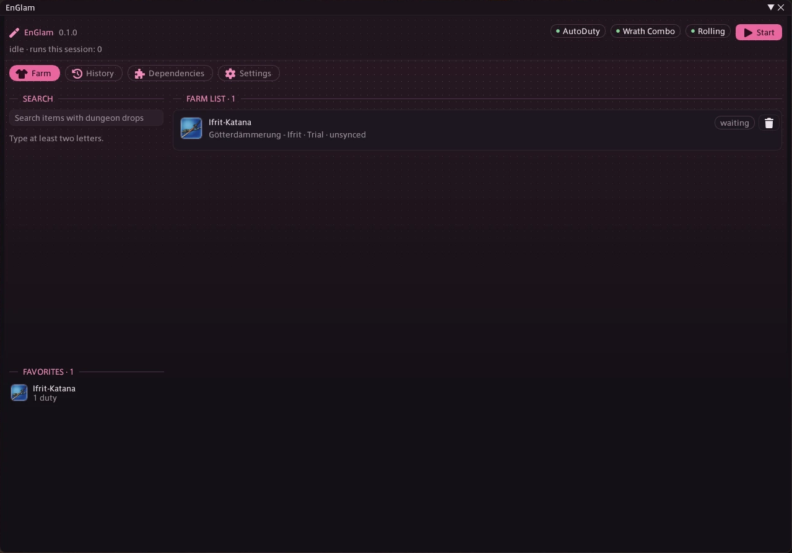
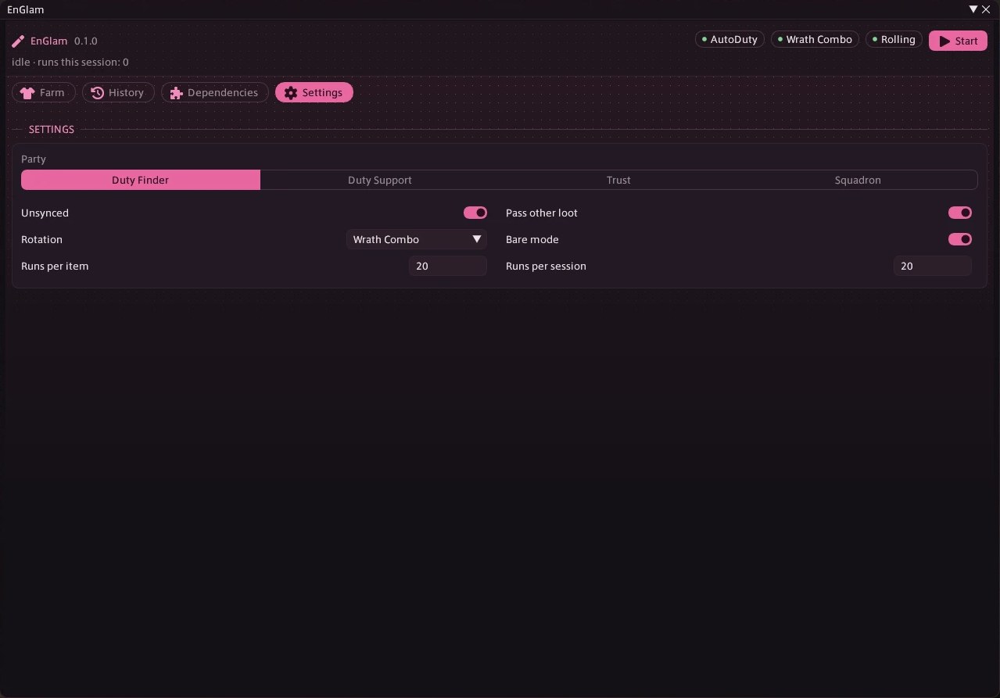

# EnGlam

Pick the glamour you want, press start, and let your other plugins farm it.





## Install

Add this repository in Dalamud under *Settings → Experimental → Custom Plugin Repositories*:

```
https://raw.githubusercontent.com/Enjuchan/EnjuPlugins/main/repo.json
```

Then install **EnGlam** from the plugin installer.

## Why

Farming a single weapon out of a trial or a dungeon chest can take dozens of runs. EnGlam
does the bookkeeping: it knows which duty drops the item, has AutoDuty run that duty one
run at a time, checks your inventory after every run, and moves on to the next item on
your list as soon as the current one is yours.

EnGlam never walks or fights itself. AutoDuty runs the duty, your rotation plugin fights,
and EnGlam decides what runs next.

## Requirements

- **AutoDuty** is required. EnGlam starts its runs through AutoDuty's IPC.
- **A rotation plugin** that AutoDuty can switch: Boss Mod, Wrath Combo or Rotation Solver
  Reborn. Without one, AutoDuty would walk the duty but not fight, so EnGlam won't start.

## How to use it

1. Open the window with `/englam`.
2. Search for an item on the left, by its name in your game language or in English. Only items
   that drop in a duty show up. Or import a whole glamour, see below.
3. Add it to the farm list. Click a card to see every duty it drops in, the chance per
   chest where known, and whether the duty is ready for you (unlocked, AutoDuty has a
   path, your level is high enough).
4. Choose the party, the rotation plugin and your limits in **Settings**, then press **Start**.

EnGlam stops on its own when every item on the list is done or a limit is reached, and
you can stop it at any time.

## Importing a glamour

The **Import** button next to the search brings a whole glamour into your farm list:

- **From Eorzea Collection**: open the glamour in your browser, press `Ctrl+U` to see the page
  source, then `Ctrl+A` and `Ctrl+C`. Click Import → *From clipboard*. EnGlam picks the items out
  of the copied page. A plain list of item names, one per line, works too.
- **From a character in game**: inspect the character, keep the window open, and click Import →
  *From inspected character*. EnGlam takes the glamour they wear, or the gear itself where nothing
  is glamoured.

Before anything is added you get a preview with every item and whether it's *farmable*, has to
be farmed yourself, can't be farmed right now (locked or level too low), has no dungeon source,
is already on your list or already owned.

EnGlam doesn't load Eorzea Collection itself: the site only lets browsers in, which is why you
copy the page source instead of pasting a link.

## Farming it yourself

Some items drop in duties AutoDuty has no path for, Savage raids for example. They get a
**farm yourself** tag with the duty you need to run, and EnGlam skips them while farming.

Run the duty yourself and EnGlam still keeps count: whenever you're not farming with EnGlam and
enter a duty that drops an open item from your list, leaving it counts as a run in the history,
and the item is ticked off as soon as it's in your inventory. This works for every open item on
the list, not only the *farm yourself* ones. In these runs EnGlam rolls Need on your items and
leaves all other loot to you.

## Tabs

- **Farm**: search, import, your favorites and the farm list with the sources of the selected item.
- **History**: everything you've farmed with EnGlam, with runs, sessions and whether you got
  it. An item stays *obtained* even if it's no longer in your inventory; *open* means you
  started but didn't get it yet.
- **Dependencies**: the plugins EnGlam works with, whether they're loaded, and an **Install**
  button for missing ones. Conflicting plugins (currently LazyLoot, which also rolls) are
  flagged.
- **Settings**: party, unsynced, rotation, bare mode, loot passing and run limits.

Right-click any item in search, favorites, farm list or history to add it to the farm list,
mark it as a favorite, or **try it on** with the game's own try-on window.

## Settings

| Setting | What it does |
|---|---|
| Party | Duty Finder, Duty Support, Trust or Squadron. With Duty Finder the duty decides the AutoDuty mode (Regular, Trial, Raid, …). |
| Unsynced | Runs duties unsynced. Only with Duty Finder; NPC parties are always synced, and AutoDuty doesn't run Dawntrail duties unsynced. |
| Rotation | Tells AutoDuty which rotation plugin to use. *AutoDuty setting* leaves AutoDuty's own choice untouched. |
| Bare mode | AutoDuty's bare mode, on by default. |
| Pass other loot | In groups with other players, rolls Pass on everything that isn't on the farm list. |
| Runs per item / per session | Hard limits so a bad drop rate can't loop forever. |

## How it works

**Drop data** comes from [LuminaSupplemental](https://github.com/Critical-Impact/LuminaSupplemental),
the same data Allagan Tools uses. The game files themselves contain no loot tables. Chest
items carry a drop rate; boss drops don't, so duties with a known rate are preferred,
then the lower-level duty.

**Runs** are started one at a time with `AutoDuty.Run`. A run counts as finished when
AutoDuty has stopped *and* you have left the duty. AutoDuty briefly reports "stopped"
while queueing and loading, so the stop alone isn't enough.

**AutoDuty settings** that EnGlam changes for farming (mode, unsynced, rotation plugin and
rotation management) are remembered first and written back when farming ends, when you
stop, and when the plugin unloads. If the game crashes in between, EnGlam restores them
the next time it loads.

**Rolling** only happens in groups with other players; solo and NPC parties get their loot
without a roll. EnGlam rolls Need on items from the farm list (Greed if Need isn't
allowed). In runs you do yourself it never passes on other loot. The roll function is found
by signature on load; if a game patch breaks it, EnGlam says so in the header and keeps farming
without rolling.

**Installing dependencies** works like Questionable's: through [ECommons](https://github.com/NightmareXIV/ECommons)
it adds the plugin's repository to Dalamud if it's missing and installs from there. This
reaches into Dalamud's internals and may break after a Dalamud update; the button then shows
the error and you can install the plugin by hand.

**Stopping on its own**: EnGlam stops cleanly when you log out, change job, AutoDuty is
unloaded, or AutoDuty sits stopped inside the duty for three minutes (death, wipe, stuck).

## Roadmap

Dungeons and trials work, and items AutoDuty can't run are tracked when you run them yourself. More is planned:

- [ ] Rolling is built but hasn't been tested in a real group with other players yet
- [ ] More sources: raids and trials as their own source, crafting through Artisan,
      gathering, vendors and currencies
- [ ] Unlock locked dungeons automatically through Questionable instead of skipping them
- [ ] Count items stored in the glamour dresser and armoire as owned (today: inventory,
      armoury and equipped gear)
- [ ] Clean up leftover plugin folders before installing a dependency, like Questionable does

## A word of caution

Automated farming is against FFXIV's terms of service, and long loops of the same duty
are easy to spot. The run limits exist for a reason.

## License

GPL-3.0, because LuminaSupplemental is GPL-3.0.
